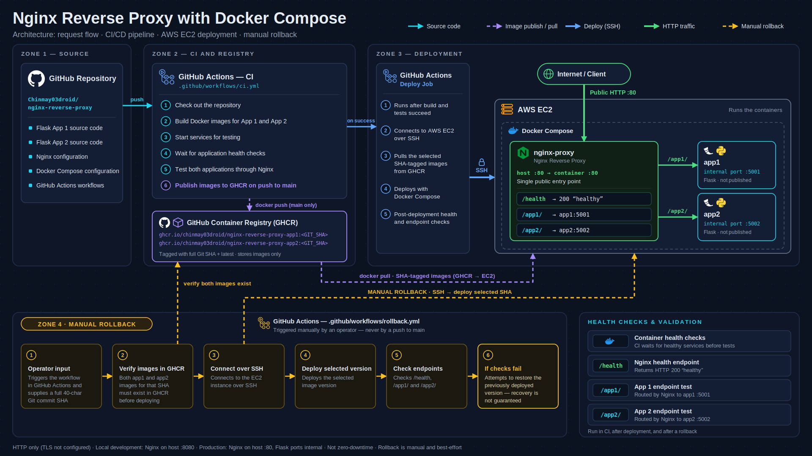

# Nginx Reverse Proxy with Docker Compose

A containerized, multi-application deployment demonstrating Nginx reverse proxying, Docker Compose, GitHub Actions CI/CD, GitHub Container Registry (GHCR), AWS EC2 deployment, and versioned rollback.

## Architecture Diagram



## Architecture

```text
                    Developer pushes to GitHub
                              |
                              v
                       GitHub Actions
                       CI: Build & Test
                              |
                              v
                     GitHub Container Registry
                       (SHA-tagged images)
                              |
                              v
                         AWS EC2
                       Docker Compose
                              |
                    +---------+---------+
                    |                   |
                    v                   v
               Flask App 1         Flask App 2
               Container           Container
                    ^                   ^
                    |                   |
                    +---------+---------+
                              |
                         Nginx Proxy
                         (Port 80)
                              ^
                              |
                           Internet
```

## Features

- Two independent Flask applications running in Docker containers.
- Nginx routes requests to the appropriate application.
- Docker Compose manages the multi-container application.
- Health checks monitor application container status.
- GitHub Actions builds and tests Docker images.
- Images are published to GitHub Container Registry (GHCR).
- SHA-tagged images support version-specific deployments.
- GitHub Actions deploys the selected image version to AWS EC2 over SSH.
- A manual GitHub Actions workflow supports rollback to a previously published image version.
- Post-deployment checks validate application endpoints.

## Tech Stack

- **Reverse proxy:** Nginx
- **Applications:** Python, Flask
- **Containers:** Docker, Docker Compose
- **CI/CD:** GitHub Actions
- **Container registry:** GitHub Container Registry (GHCR)
- **Cloud:** AWS EC2
- **Operating system:** Linux

## Request Routing

| Endpoint | Destination |
|---|---|
| `/app1/` | Flask App 1 |
| `/app2/` | Flask App 2 |
| `/health` | Nginx health endpoint |

## Run Locally

### Prerequisites

- Docker
- Docker Compose plugin

Clone the repository:

```bash
git clone https://github.com/Chinmay03droid/nginx-reverse-proxy.git
cd nginx-reverse-proxy
```

Build and start the services:

```bash
docker compose up --build -d
```

Check container status:

```bash
docker compose ps
```

Test the application routes:

```bash
curl http://localhost:8080/app1/
curl http://localhost:8080/app2/
```

The local Compose configuration publishes Nginx on port `8080`.

Stop the services:

```bash
docker compose down
```

## CI/CD Pipeline

The GitHub Actions workflow in `.github/workflows/ci.yml` performs these steps:

1. Checks out the repository.
2. Builds the two Flask application images.
3. Starts the services and waits for application health checks.
4. Tests the application routes through Nginx.
5. Publishes SHA-tagged and `latest` images to GHCR on pushes to `main`.
6. Deploys the selected SHA-tagged images to AWS EC2.
7. Checks the health endpoint and both application routes after deployment.

The deployment uses the Git commit SHA as the image tag, making the deployed version identifiable and reproducible.

## Manual Rollback

The workflow in `.github/workflows/rollback.yml` accepts a full 40-character Git commit SHA.

To run it:

1. Open the repository's **Actions** tab on GitHub.
2. Select **Rollback Deployment**.
3. Click **Run workflow**.
4. Enter the full SHA corresponding to a previously published image.
5. Start the workflow and inspect its result.

The requested images must already exist in GHCR.

The rollback workflow records the currently running image tag and attempts to restore that version if deployment checks fail. Recovery can itself fail, so inspect the workflow logs if a deployment or restoration fails.

### Rollback Test

A rollback was tested using this image tag:

`2845c9e2e9244d9ce2d81c250a0247f846eb9a3d`

After the workflow completed, both running containers were verified to use that tag. The health endpoint and both application endpoints returned successful responses.

## Deployment Configuration

The production deployment runs on AWS EC2 using Docker Compose and GHCR images.

GitHub repository secrets are used for deployment credentials and connection configuration. Private keys should not be committed to the repository.

The public deployment address may change when the EC2 instance is stopped and restarted unless a stable address is configured.

## Repository Structure

```text
nginx-reverse-proxy/
├── app1/
├── app2/
├── nginx/
├── .github/
│   └── workflows/
│       ├── ci.yml
│       └── rollback.yml
├── docker-compose.yml
└── README.md
```

## Future Improvements

- Configure HTTPS with a domain and TLS certificate.
- Pin infrastructure images to explicit versions or digests.
- Restrict SSH access to trusted sources.
- Improve deployment recovery and failure reporting.
- Add monitoring and centralized logging.

## Author

Chinmay — Aspiring DevOps Engineer

GitHub: https://github.com/Chinmay03droid
